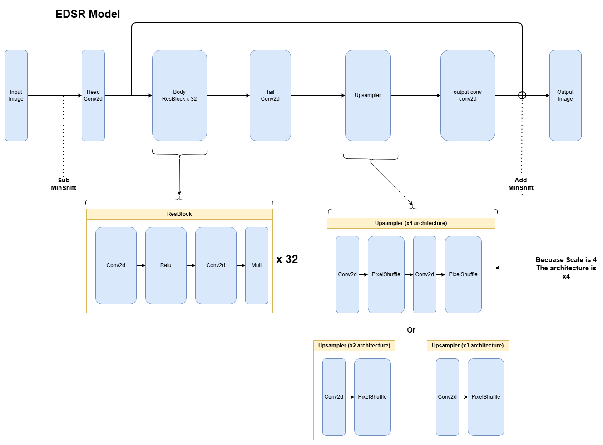
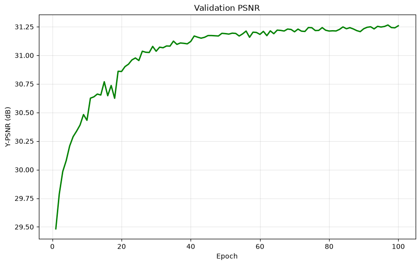
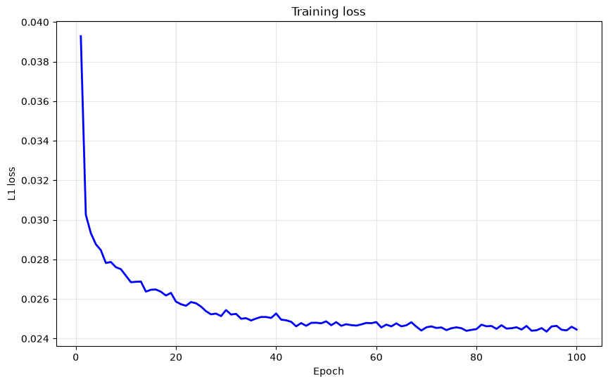
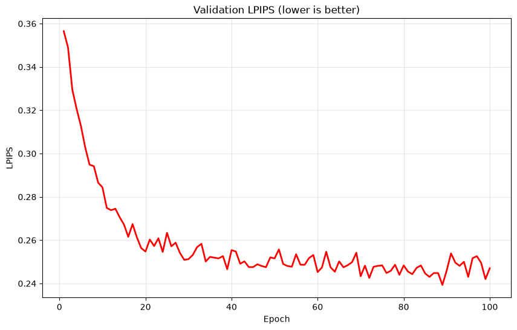

# Image Super-Resolution with EDSR

x4 single-image super-resolution on DIV2K with EDSR (Lim et al., 2017), written from scratch in PyTorch. Deep Learning course project at VUB, August 2026, done with Hamed Nikoo and Fahimeh Safari Moghadam. This is my copy of the final code, report and poster.

## Results

DIV2K validation, 100 images, x4, metrics on the Y channel with a 4-pixel shaved border:

| Method | PSNR | SSIM | LPIPS |
|---|---:|---:|---:|
| Bicubic (MATLAB-compatible) | 28.09 dB | 0.7744 | 0.4139 |
| VDSR (reported) | 28.00 dB | | |
| **EDSR, this run** | **30.41 dB** | **0.8371** | **0.2804** |
| EDSR + 8x self-ensemble | 30.48 dB | 0.8384 | 0.2828 |

+2.32 dB over bicubic and +2.41 dB over VDSR. The self-ensemble adds 0.07 dB of PSNR and slightly worsens LPIPS, so the single pass is the better perceptual choice. On individual crops the gain is far larger than the average: +5.31 dB on the rose close-up on the poster.



| Validation PSNR | Training L1 loss | Validation LPIPS |
|---|---|---|
|  |  |  |

`report.pdf` has the ablations and the qualitative comparisons, `poster.pdf` the one-page summary.

## Method

- **Data**: DIV2K, downloaded on first run. 20 random 48 x 48 low-resolution patches per image per epoch, with flips, rotation and transpose so the augmentation covers all 8 symmetries the self-ensemble averages over.
- **Model**: EDSR with 32 residual blocks of 128 features, no batch norm, residual scaling, MeanShift normalisation at input and output, PixelShuffle upsampling. About 43 M parameters.
- **Training**: L1 loss, Adam at 1e-4 halved at epochs 25 and 40, batch 32, 100 epochs. Everything seeded, including dataloader workers, and the random state is saved in the checkpoints so a resumed run matches an uninterrupted one.
- **Model selection**: 10 images held out from the training set. The 100 official validation images are the test set and are scored once, at the end, with the best checkpoint.
- **Evaluation**: one function for PSNR, SSIM and LPIPS, used both during training and at the end, on identical Y-channel pixels.

## What it ran on

VUB ETRO GPU farm: 4x NVIDIA A100 80 GB, driver 535.247.01, CUDA 12.1.1, AMD EPYC 9124. The final run on 18 August 2026 took 7 h 9 min for the 100 epochs. The notebook was executed end to end with papermill, and the executed outputs are kept in it.

## Running it

```bash
pip install -r requirements.txt
jupyter notebook image_super_resolution.ipynb
```

Run the cells in order. The first cell installs `lpips`, `prettytable` and `gdown`; DIV2K downloads on first run. To train from scratch rather than resume, set `resume_path = None` in `TrainConfig`.

## Report and poster

LaTeX sources in `latex/`, using the VUB `vub` package ([texlive-vub](https://gitlab.com/rubdos/texlive-vub)). Build with `latexmk -pdf main.tex` in `latex/` and `latexmk -pdf poster.tex` in `latex/poster/`.
